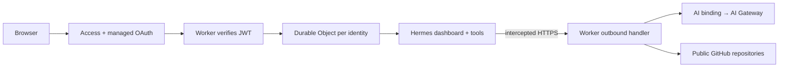

# Hermes web dashboard on Cloudflare

Run the [native Hermes web dashboard](https://hermes-agent.nousresearch.com/docs/user-guide/features/web-dashboard) in a Cloudflare container. Sign in through Cloudflare Access, open **Chat**, and use the real Hermes terminal in your browser. Each signed-in identity gets its own container and workspace.

Model calls go through **Cloudflare AI Gateway** using the Worker's AI binding. No model API key or Cloudflare API token enters the container. This example does not use OpenRouter.



The dashboard, Node terminal UI, Python agent, shell, and files all run inside the container. The Worker forwards HTTP and WebSocket traffic to port 9119. It uses the current native Container API; no Hermes fork or custom agent loop is needed.

**State is temporary.** Refreshing the browser reuses a running container. Containers stop after 15 minutes of inactivity, and their files, sessions, memory, and settings are lost on stop or replacement. Export work before leaving. The browser can keep WebSockets open, so an open tab may keep its container running.

## Deploy

You need Node.js 22+, Docker, a Cloudflare account with Containers enabled, AI Gateway model billing configured, and a Zero Trust organization.

```sh
git clone https://github.com/irvinebroque/nous-research-hermes-agent-cloudflare-sandbox.git
cd nous-research-hermes-agent-cloudflare-sandbox
npm ci
npx wrangler login
```

1. Create an [AI Gateway](https://developers.cloudflare.com/ai-gateway/get-started/) and enable [Unified Billing](https://developers.cloudflare.com/ai-gateway/features/unified-billing/) for `openai/gpt-4.1-mini`. Set `AI_GATEWAY_ID` in `wrangler.jsonc`. The AI binding handles authentication; do not paste your CLI OAuth token into the app.
2. Choose the Worker name in `wrangler.jsonc`. Its URL is `https://<worker-name>.<workers-subdomain>.workers.dev`.
3. Create a [self-hosted Access application](https://developers.cloudflare.com/cloudflare-one/access-controls/applications/http-apps/self-hosted-public-app/) for that entire hostname. Configure the [Google identity provider](https://developers.cloudflare.com/cloudflare-one/integrations/identity-providers/google/), select only Google for this application, and enable automatic redirect to the identity provider. Use an **External** Google OAuth audience to support personal Gmail and accounts from multiple organizations. Add an **Allow** policy with three **Include → Emails ending in** entries: `gmail.com`, `cloudflare.com`, and `snappr.co`. Include entries are alternatives: a Google-authenticated address from any one of these domains is allowed. Do not put the three domains under Require. Choose your own allowed domains when deploying a different audience.
4. Enable [managed OAuth](https://developers.cloudflare.com/cloudflare-one/access-controls/applications/http-apps/managed-oauth/) on the application. Enable dynamic client registration and localhost/loopback redirects if you want CLI OAuth clients. Google authenticates browser users; managed OAuth adds authorization-code/PKCE support for non-browser clients.
5. Copy the application's audience tag into `ACCESS_AUD` and your `<team>.cloudflareaccess.com` domain into `ACCESS_TEAM_DOMAIN` in `wrangler.jsonc`. These are identifiers, not secrets.
6. Deploy:

   ```sh
   npm run deploy
   ```

Open the deployed URL and sign in with Google. The first request starts your container and may take a minute. Open **Chat** and try:

> Create hello.py and a unittest for it in /workspace. Run the test and explain what you changed.

Approve tool requests in the dashboard when prompted. The model is preset. You do not need a second Hermes login or a model API key. The dashboard's **Log out** action logs out of Access. Hermes's own “Gateway Status” refers to its messaging gateway, not Cloudflare AI Gateway; it can show Off while Chat works.

To verify managed OAuth discovery:

```sh
curl https://<worker-name>.<workers-subdomain>.workers.dev/.well-known/oauth-authorization-server
```

An OAuth client must send the dashboard's origin as its `resource` parameter, use PKCE, and send its access token as `Authorization: Bearer …`. Access turns that token into a signed assertion before forwarding the request. Never commit tokens or cookie exports.

## How the example works

| File | Purpose |
| --- | --- |
| [`Dockerfile`](Dockerfile) | Pins Hermes, builds its web and terminal UIs, and installs locked Python dependencies. |
| [`start-dashboard.py`](start-dashboard.py) | Writes initial model/tool settings, then starts the upstream dashboard with prebuilt assets. |
| [`src/index.ts`](src/index.ts) | Verifies Access signature, issuer, audience and expiry; maps the verified identity to a Durable Object. |
| [`src/sandbox.ts`](src/sandbox.ts) | Starts the container, waits for HTTP readiness, and proxies HTTP/WebSockets. |
| [`src/outbound.ts`](src/outbound.ts) | Allows the selected model through AI Gateway and public GitHub HTTPS; rejects other destinations. |
| [`wrangler.jsonc`](wrangler.jsonc) | Declares the Container image, Durable Object, AI binding and nonsecret settings. |

Hermes requires authentication when listening on `0.0.0.0`. Each Durable Object generates a random password for its private Hermes backend and obtains a backend session. Browser authentication remains entirely with Access. The proxy strips incoming Access credentials and uses the private backend session; backend session cookies are not sent to the browser. Nothing uses `--insecure` or disables Hermes authentication.

Hermes is configured with the `custom` provider and `https://model.internal/v1`. Container HTTPS interception handles that hostname before any public network connection. The handler validates the model and calls:

```ts
await env.AI.run(model, inputs, {
  gateway: { id: env.AI_GATEWAY_ID, skipCache: true },
  returnRawResponse: true,
});
```

The raw response preserves streaming and tool calls. `OPENAI_API_KEY=provided-by-worker` is only a placeholder for Hermes's client. For GPT-4.1 mini, the bridge removes Hermes's default `reasoning_effort` option because that model rejects it.

The initial toolsets are `terminal` and `file`. Tools can control their entire container. Other Internet destinations, runtime package downloads, browser tools, external integrations, and alternate model providers are not enabled by this example. GitHub access is unauthenticated. This is a small dashboard demo, not a complete hosted version of every Hermes feature.

The deployed demo uses Google sign-in and admits authenticated `gmail.com`, `cloudflare.com`, and `snappr.co` addresses. Any admitted visitor can consume your model and container budget. Set AI Gateway rate limits appropriate to your demo. The network boundary keeps inference credentials outside the container; it is not a per-user spending quota.

## Check it

```sh
npm run check
npm test
docker build --platform linux/amd64 -t hermes-cloudflare-sandbox:test .
docker run --rm --platform linux/amd64 --network none \
  -v "$PWD/test:/test:ro" hermes-cloudflare-sandbox:test \
  python3 /test/dashboard-smoke.py
docker run --rm --platform linux/amd64 --network none \
  -v "$PWD/test:/test:ro" hermes-cloudflare-sandbox:test \
  python3 /test/hermes-smoke.py
```

The dashboard smoke test exercises the real frontend, authentication, embedded Node terminal, WebSocket, Python agent, file tool, and terminal tool with a deterministic local model. It makes no paid inference calls. Unit tests cover the Access boundary, identity isolation, private-session forwarding and AI Gateway bridge.

For a live check, sign in, send the sample task through **Chat**, and verify the corresponding successful requests in AI Gateway. See [`docs/production.md`](docs/production.md) for the deployment verification record.

`.env*`, `.dev.vars*`, `.wrangler/`, and generated bindings are ignored. The Docker build context allowlists only the Dockerfile and startup script. No deployment credential is needed in GitHub Actions.

## Documentation

- [`docs/hermes.mdx`](docs/hermes.mdx): Cloudflare documentation page for `/sandbox/coding-agents/hermes/`.
- [`docs/coding-agents-index.patch`](docs/coding-agents-index.patch): card for the existing coding-agents overview.
- [`docs/research.md`](docs/research.md): upstream sources and design decisions.
- [`docs/README.md`](docs/README.md): docs publication instructions.
